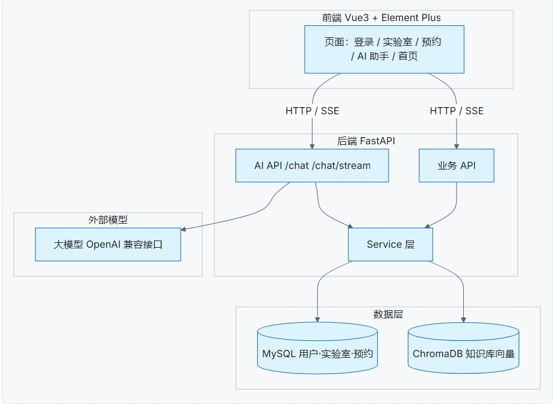
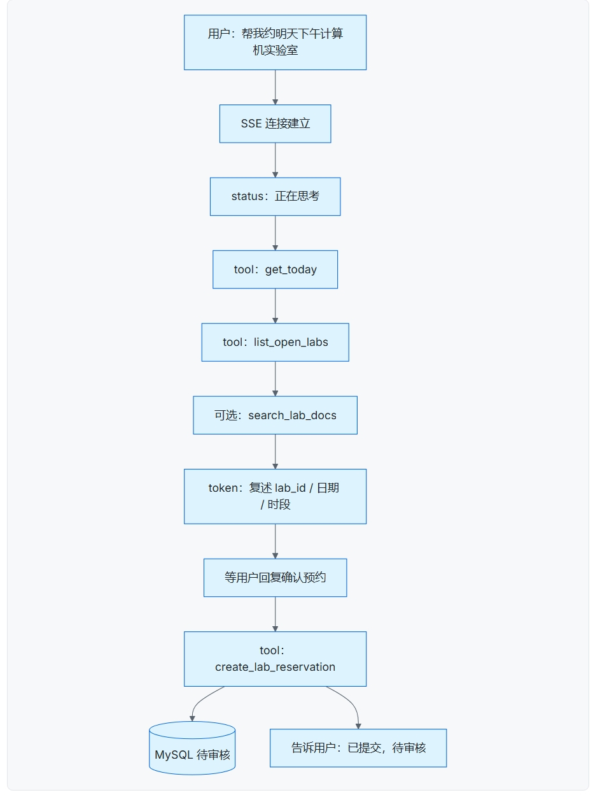
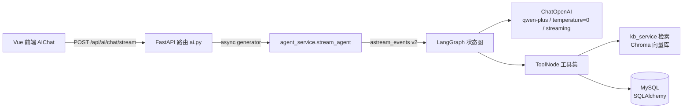
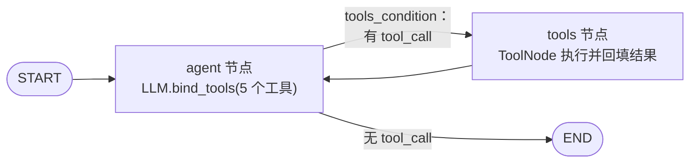
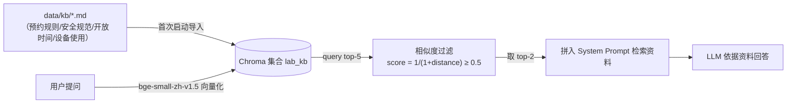

# 智能实验室预约系统（lab-agent）

基于 **FastAPI + Vue 3** 的前后端分离实验室预约管理平台，内置 **AI 智能助手（RAG + Agent）**：可检索实验室知识库、查询实时开放的实验室与设备，并在用户确认后协助提交预约。

## 项目简介

系统面向高校/机构实验室场景，提供以下核心能力：

- **用户体系**：注册 / 登录（JWT 鉴权，密码 bcrypt 加密存储），支持 `student`（学生）与 `admin`（管理员）两种角色；管理员可管理用户、禁用账号。

- **实验室管理**：实验室的增删改查、分页与关键字筛选、开放/关闭状态、开放时间段维护。

- **设备管理**：设备 CRUD，与实验室绑定，支持按实验室、按关键字、按状态（正常/维修）查询。

- **预约与审核**：学生按日期 / 时段预约实验室或单个设备，管理员审核（通过 / 拒绝）；含时段冲突检测、开放时间校验、实验室关闭校验、设备维修校验；后台每分钟自动扫描，将已过期的「待审核」预约置为「已取消」。

- **AI 智能助手**：基于 LangGraph 的 Agent 工作流，SSE 流式输出，可调用 5 个真实工具——知识库检索、开放实验室查询、实验室设备查询、创建预约（需用户确认）、获取今天日期。（完整架构见下文「🧠 AI 智能助手（Agent）架构」章节）

- **知识库 RAG**：Chroma 向量库 + `BAAI/bge-small-zh-v1.5` 中文 Embedding 模型，知识源为 `backend/data/kb/*.md`，回答规则 / 安全 / 开放时间类问题时自动引用。

- **文件上传**：头像 / 封面图片等通用上传，100MB 上限，白名单扩展名，落盘到 `backend/uploads/` 并以 `/uploads/...` 静态访问。



#### 智能体流程



### 🧠 Agent 记忆体系的工程探索

在实现智能体对话记忆时，调研了当前三类典型记忆实现方案，本项目采用**消息列表拼接**的实现方式，同时对比另外两种主流方案。**结论先行：方案 1 已落地，方案 2/3 为调研对比，方案 3 列为下一迭代方向。**

1. **简单消息拼接记忆（本项目采用）**
   将用户与大模型完整对话历史维护在内存 `messages[]` 列表，每一轮请求把全部历史消息一并传给 LLM，配合 LangGraph 完成工具调用流转。
   - 优点：实现简单，不需要额外存储组件，工具调用链路稳定；
   - 缺点：服务重启、会话刷新记忆全部丢失；对话轮次越多上下文 token 持续膨胀；没有做记忆压缩、持久化存储。

2. **基于框架的结构化记忆（LangGraph Checkpointer + Store，本项目未采用）**
   LangGraph 原生提供的记忆方案，`Checkpointer` 保存 Agent 每一步执行快照，`Store` 存放跨会话实体事实记忆，支持会话断点恢复、Human-in-the-loop 暂停等待人工输入。
   - 优点：原生适配 LangGraph 工作流，可以暂停、恢复 Agent 执行状态；
   - 缺点：引入额外持久化存储，增加系统复杂度；业务简单场景下属于过度设计。本项目优先保证业务链路稳定，因此没有接入该套持久记忆。

3. **Claude Code 式「文件驱动分层记忆」（重点调研，本项目未落地）**
   一套不依赖框架内部状态的记忆架构，核心是**按「生命周期 + 作用域」给记忆分层**：

   - **静态层（`CLAUDE.md`）**：启动即加载的持久指令。
   - **会话层**：后台 fork 的子 Agent 在 Token 达到阈值（约 1 万）时，把本轮内容压缩成会话摘要（`session-memory/summary.md`），会话结束即弃。
   - **长期层（Auto Memory + `MEMORY.md` 索引）**：只沉淀「项目决策、用户偏好、业务约束、踩坑结论」等高价值事实，落成带 YAML frontmatter 的 Markdown 分片，`MEMORY.md` 作索引。
   - **注入层（Relevant Memories）**：新会话按需检索相关记忆注入，而非把全量历史塞进上下文。

   （参考官方文档：[Claude Code Memory](https://code.claude.com/docs/en/memory)）

   **取舍：** 优——与框架解耦、跨会话跨进程持久、按需注入控制上下文、记忆可读可编辑并随 Git 管理；缺——需自建提取子 Agent、去重、过期清理、大小治理，提取质量强依赖提示词，检索路由需自行实现。

   **为什么不落地：** 本项目对话轮次短、无跨会话持久诉求，优先保证工具调用 / RAG / 预约确认主链路稳定；且项目已内置 Chroma（`kb_service`），未来复用向量库 + 补一个摘要子 Agent 即可低成本升级。

   > **不存在真正的「AI 原生记忆」——LLM 记忆的本质，是「在合适的时机，把最相关的一段文本喂给模型」，区别只在于存储位置、触发时机与压缩/检索策略。**
   > 因此记忆系统的真正难点不在「存」，而在「召回与裁决」：哪些事实值得长期保留、如何在有限上下文里选中最相关几条、如何避免陈旧结论被反复「重开」——这是本项目下一步最想攻克的工程点。
  

## 技术栈

### 后端（backend/）

| 类别 | 技术 |
| --- | --- |
| Web 框架 | FastAPI 0.115（Uvicorn 0.34 运行） |
| ORM / 数据库 | SQLAlchemy 2.0 + PyMySQL，MySQL 8 |
| 配置 | pydantic-settings（读取 `backend/.env`） |
| 认证 | PyJWT（HS256）+ OAuth2 Bearer |
| 密码 | bcrypt |
| AI | OpenAI SDK（兼容阿里云百炼 DashScope 接口）、langchain-openai 1.6、langgraph 1.2、langchain-core |
| 向量库 | chromadb 1.5、sentence-transformers 6.0（Embedding: BAAI/bge-small-zh-v1.5） |
| 文件 | python-multipart（流式写盘） |

### 前端（frontend/）

| 类别 | 技术 |
| --- | --- |
| 框架 | Vue 3.5 + Vite 8 |
| UI | Element Plus 2.14 + @element-plus/icons-vue |
| 路由 | Vue Router 5 |
| 请求 | axios（统一 Token 注入与 401 处理） |
| 其它 | marked + dompurify（Markdown 渲染）、prettier |
| Node 要求 | `^22.18.0` 或 `>=24.12.0`（见 frontend/package.json engines） |

### 其它

- **部署**：Docker（`docker-compose.yml` + `backend/Dockerfile`），Python 3.11 slim 镜像，国内镜像源（阿里 PyPI 镜像、hf-mirror）。
- **数据库脚本**：`sql/lab_agent.sql`（MySQL 8 导出，含 8 个实验室、32 个设备、示例用户的完整演示数据）。

## 🧠 AI 智能助手（Agent）架构

AI 助手是整个项目最核心的工程部分：不是简单的「调一次 LLM」，而是一个**可控、可观测、可落库**的 LangGraph Agent，叠加 Chroma 向量库的 RAG 检索与 SSE 流式交互。下面按链路逐层拆解。

### 总体架构



一次提问被拆成**可流式推给前端的内部事件**（思考中 → 调工具 → 逐字吐 token → 完成），而不是等最终结果一次性返回。

### Agent 工作流（LangGraph 状态图）

核心实现见 `backend/app/services/agent_service.py` 的 `build_agent()`，是一个标准 **ReAct 式的 Agent + Tools 双节点图**：



关键参数与设计：

- **模型配置**：`ChatOpenAI` 接入阿里云百炼 DashScope 兼容接口，`temperature=0`（保证输出稳定可复现）、`streaming=True`（打开逐字流）、`.bind_tools(tools)` 把工具声明注入模型。
- **循环上限**：`recursion_limit=10`，防止模型在「提问 → 调工具 → 再提问」之间无限往返，超限自动终止。
- **状态管理**：`MessagesState` 承载完整 `messages` 列表，工具结果作为 `ToolMessage` 追加回图，再喂回 `agent` 节点决策——正是标准 ReAct 循环。

### 工具集（Tools）

工具定义见 `backend/app/services/agent_tools.py` 的 `build_tools()`，共 5 个，**读写工具都走真实业务 Service，与普通 HTTP 接口共享同一套校验逻辑**：

| 工具 | 参数 | 职责 | 类型 |
| --- | --- | --- | --- |
| `search_lab_docs` | `query` | 检索知识库（规则/安全/开放时间） | 只读 |
| `list_open_labs` | `keywords?` | 查询状态为「开放」的实验室（复用 `lab_service` 分页） | 只读 |
| `list_lab_equipments` | `lab_id`, `keywords?` | 查询某实验室下设备（复用 `equipment_service`） | 只读 |
| `create_lab_reservation` | `lab_id`, `date`, `start_time`, `end_time`, `equipment_id?`, `remark?` | 真实提交预约，复用 `reservation_service.create_reservation` 全部业务校验（时间冲突、开放时间、设备维修等） | **写操作** |
| `get_today` | 无 | 取服务器当天日期，供「今天/明天」日期换算 | 只读 |

两处工程细节值得一提：

- **闭包注入身份**：`build_tools(db, current_user)` 用闭包把当前 HTTP 请求的 `db` 会话和登录用户对象捕获进工具内部——Agent 的写操作天然以「登录用户本人」身份落库，权限不靠 LLM 自觉。
- **写操作有强约束**：`create_lab_reservation` 内部不自己拼 SQL，而是委托给与 `POST /api/reservation` 完全相同的 `reservation_service.create_reservation`，避免「AI 通道」和「普通表单通道」出现两套不一致的校验规则。

### 流式交互协议（SSE）

路由 `POST /api/ai/chat/stream`（`app/api/ai.py`）返回 `text/event-stream`；生成器 `stream_agent()` 基于 LangGraph 的 `astream_events(version="v2")`，把图内部事件转换成前端可消费的语义事件：

| 事件 `type` | 触发时机 | 字段 | 前端行为 |
| --- | --- | --- | --- |
| `status` | 流程开始 | `message` | 显示「正在思考…」 |
| `tool_start` | 模型决定调用某工具 | `name`, `label` | 展示该工具的中文名称（过程可视化） |
| `tool_end` | 工具执行完成 | `name`, `label`, `preview` | 展示工具结果的前 200 字预览 |
| `token` | 模型逐字输出 | `content` | 打字机式追加到聊天区 |
| `done` | 正常结束 | — | 结束本轮 |
| `error` | 业务/未知异常 | `message` | 错误提示（流内同样以事件抛出） |

配套细节：

- **中文过程文案**：`TOOL_LABELS` 把工具英文名映射成「检索实验室知识库 / 查询开放实验室 / 提交预约」等，让用户看得懂 Agent 正在做什么。
- **内容兼容**：`_chunk_text()` 统一处理 chunk 的 `content`（既可能是 `str`，也可能是 `[{type,text}]` 块列表），`_tool_output_preview()` 把工具返回的长 JSON 截断成 200 字预览，避免刷屏。
- **噪声过滤**：`on_chat_model_stream` 只保留 `langgraph_node` 为 `agent` 的 token，丢弃 LangGraph 其它内部节点的输出。

### RAG 知识库链路

实现见 `backend/app/services/kb_service.py`：



- **文档粒度**：每个 `.md` 全文作为一个 document 入库（`id` = 文件名 stem，`metadata.source` = 文件名），当前业务文档短小，未做分块。
- **入库时机**：仅当集合为空（`col.count() == 0`）时导入一次，避免重复写入。
- **检索与重排**：取相似度阈值 0.5 以上的 top-2 片段，格式化后注入 `SYSTEM_PROMPT` 的「以下是检索到的实验室资料」段落。
- **懒加载 + 单例**：Embedding 模型 `SentenceTransformerEmbeddingFunction` 通过 `get_embedding_fn()` 懒加载并全局复用，避免每请求重复加载。
- **启动预热**：`main.py` 的 `lifespan` 中用 `asyncio.to_thread(kb_service.warmup)` 把「模型加载 + 首次检索」放在启动阶段完成（约 15s），避免落在首个用户请求上导致前端 30s 超时。

### 安全护栏与防幻觉

全部落在 `agent_service.py` 的 `SYSTEM_PROMPT` 与工具流程约束中，是 Agent 与真实业务系统对接时最容易踩、也最体现工程成熟度的部分：

1. **预约前强制确认**：模型在调用 `create_lab_reservation` 前，必须先复述（实验室/设备的 ID 与名称、日期、开始/结束时间），并等到用户明确回复「确认 / 确认预约 / 就这样预约」才能动手。
2. **先查后建，禁止编造**：确认环节若缺 `lab_id` 必须先 `list_open_labs` 查到；缺 `equipment_id` 必须先 `list_lab_equipments` 查到；明令「不要瞎编数据库里没有的实验室或设备」。
3. **只读能力边界**：Agent 不能替用户改数据库、不能绕过审核；预约提交后是「待审核」态，须管理员确认后方可用。
4. **日期不臆测**：涉及「今天/明天/后天」先调 `get_today`，禁止模型凭训练日期凭空作答。
5. **回答有据**：开放时间、规则类问题优先 `search_lab_docs`，不凭空回复。

### 演进记录

早期实现（`app/services/ai_service.py`，路由已注释）是 **OpenAI 原生 function calling**：`tool_choice="auto"` + 最多 3 轮手工 `tool_calls` 循环。后迁移到 **LangGraph**，换取的是：图结构描述清晰、`astream_events` 天然支持流式事件、`ToolNode`/`tools_condition` 免去手写循环与消息回填。这段演进可在面试中作为「为什么从手写 function calling 迁移到 Agent 框架」的论据。

## 目录结构

```
lab-agent
├── docker-compose.yml          # 后端 Docker 编排（host 网络模式）
├── sql/
│   └── lab_agent.sql           # MySQL 初始化脚本（建表 + 演示数据）
├── backend/                    # FastAPI 后端
│   ├── .env                    # 本地配置（含密钥，勿提交）
│   ├── Dockerfile              # Python 3.11 + uvicorn
│   ├── requirements.txt        # Python 依赖
│   ├── app/
│   │   ├── main.py             # 应用入口：CORS、异常处理、启动预热向量库、后台扫描任务
│   │   ├── config.py           # 环境变量定义、上传限制与白名单
│   │   ├── database.py         # SQLAlchemy engine / Session / Base
│   │   ├── api/                # 路由层（统一前缀 /api）
│   │   │   ├── auth.py         # 登录 / 注册
│   │   │   ├── user.py         # 用户信息、密码修改、用户管理
│   │   │   ├── lab.py          # 实验室管理
│   │   │   ├── equipment.py    # 设备管理
│   │   │   ├── reservation.py  # 预约列表 / 创建 / 取消 / 审核
│   │   │   ├── files.py        # 文件上传
│   │   │   └── ai.py           # AI 对话 SSE 流（/api/ai/chat/stream）
│   │   ├── models/             # SQLAlchemy 模型：user/lab/equipment/reservation
│   │   ├── schemas/            # Pydantic 请求 / 响应模型
│   │   ├── services/           # 业务逻辑层
│   │   │   ├── agent_service.py    # LangGraph Agent 工作流（流式）
│   │   │   ├── agent_tools.py      # Agent 工具：搜知识库/查实验室/查设备/提交预约/取日期
│   │   │   ├── ai_service.py       # 普通 OpenAI 对话 + 工具调用（未启用路由）
│   │   │   ├── kb_service.py       # Chroma 向量库：加载知识库、检索、启动预热
│   │   │   ├── reservation_service.py  # 预约校验 + 每分钟过期扫描任务
│   │   │   └── ...
│   │   ├── common/             # 统一响应封装、异常与异常处理器
│   │   ├── dependencies/       # JWT 鉴权依赖（get_current_user / get_current_admin）
│   │   └── utils/              # jwt、password 工具
│   ├── data/
│   │   ├── kb/                 # 知识库源文档（.md：预约规则/安全规范/开放时间/设备使用）
│   │   └── chroma/             # 向量库持久化目录（运行时生成）
│   └── uploads/                # 上传文件存储（运行时生成）
├── frontend/                   # Vue3 前端
│   ├── index.html
│   ├── vite.config.js          # /api、/uploads 代理到 127.0.0.1:8000
│   ├── .env.development        # VITE_API_BASE_URL
│   ├── package.json
│   └── src/
│       ├── main.js             # 入口（Element Plus 中文语言包）
│       ├── router/index.js     # 路由 + Token 守卫
│       ├── layouts/Layout.vue  # 主布局（侧边导航）
│       ├── views/              # 页面：Home/Lab/LabList/LabEquipment/Equipment/
│       │                       #   MyReservation/AuditReservation/AIChat/
│       │                       #   Profile/Password/User/Login/Register
│       ├── components/ReserveDialog.vue
│       ├── api/                # 各模块 axios 封装
│       └── utils/              # request（拦截器）/auth（Token）/user
└── deploy/                     # 服务器部署副本：backend.zip 及其解压内容
    └── backend/                # 与 backend/ 内容一致的打包副本
```

## 环境准备

1. **Python 3.11+**（后端）
2. **Node.js** `^22.18.0` 或 `>=24.12.0`（前端，见 `frontend/package.json` engines）
3. **MySQL 8**：创建数据库（脚本内默认库名 `lab_agent`），可导入 `sql/lab_agent.sql` 获得演示数据（含 8 个实验室、32 个设备、示例用户，其中包含 `admin` 管理员账号——正式使用前请修改默认密码）
4. **大模型 API**（AI 功能需要）：阿里云百炼 DashScope 的 **专有（专属）MaaS 节点**，提供兼容 OpenAI 格式的接口地址（`/compatible-mode/v1`）与 API Key。未配置时仅 AI 助手不可用，其余功能不受影响

## 安装 & 启动

### 方式一：本地开发

**① 配置后端环境变量**

```bash
cd backend
cp example.env .env      # Windows: copy example.env .env
# 编辑 .env，填入数据库连接与大模型配置（不要提交含密钥的 .env）
```

**② 启动后端**

```bash
cd backend
pip install -r requirements.txt -i https://pypi.tuna.tsinghua.edu.cn/simple
uvicorn app.main:app --host 127.0.0.1 --port 8000
```

启动说明：

- 首次运行会自动执行 `Base.metadata.create_all` 建表（需数据库已提前创建）；
- 启动阶段会预热向量库：加载 `BAAI/bge-small-zh-v1.5` Embedding 模型（首次需联网下载，约 15s，国内走 `hf-mirror`），并把 `data/kb/*.md` 写入 Chroma（仅向量库为空时导入）；
- 后台每分钟自动扫描过期预约。

**③ 启动前端**

```bash
cd frontend
npm install
npm run dev
```

访问 http://localhost:5173 ，前端已通过 Vite 代理将 `/api`、`/uploads` 转发到 `http://127.0.0.1:8000`。

也可在 VS Code 中直接运行 `.vscode/launch.json` 提供的 **"Python Debugger: FastAPI"** 调试配置启动后端。

### 方式二：Docker 部署后端

```bash
docker compose up -d --build
```

说明：

- 使用 `network_mode: host` 直连宿主机的 `127.0.0.1:3306` MySQL（**host 网络模式仅 Linux 可用**；Windows/Mac Desktop 不支持时请改用默认桥接网络映射端口）；
- 容器内环境变量以 `docker-compose.yml` 的 `environment` 为准（其优先级高于挂载进容器的 `.env`），部署前请替换其中示例的数据库账号密码；
- 自动挂载 `backend/.env`、`backend/uploads`、`backend/model-cache`（HuggingFace 模型缓存，避免每次重建后重新下载模型）；
- `HF_ENDPOINT=https://hf-mirror.com` 已内置，走国内镜像。

## 配置说明（环境变量）

> 模板见 `backend/example.env`（仅变量名，无真实值）。**任何真实密钥都只在本地 `.env` 中填写，不得提交到版本库。**

| 变量 | 说明 | 示例 / 备注 |
| --- | --- | --- |
| `DATABASE_URL` | MySQL 连接串 | `mysql+pymysql://<用户>:<密码>@127.0.0.1:3306/lab_agent` |
| `JWT_SECRET_KEY` | JWT 签名密钥 | 建议随机长字符串，如 `openssl rand -hex 32` |
| `JWT_ALGORITHM` | JWT 算法（默认 HS256） | 可选 |
| `JWT_EXPIRE_HOURS` | Token 有效期（小时，默认 24） | 可选 |
| `LLM_API_KEY` | 阿里云百炼 API Key | AI 功能必填 |
| `LLM_BASE_URL` | 兼容 OpenAI 格式的接口地址 | 如 `<专属节点>/compatible-mode/v1` |
| `LLM_MODEL` | 模型名 | 如 `qwen-plus` |

前端开发地址配置见 `frontend/.env.development`（`VITE_API_BASE_URL`）。

## API 概览

统一前缀 `/api`，除登录/注册外均需 `Authorization: Bearer <token>`；管理员专属接口需 `admin` 角色。响应统一格式：`{ "code": 200, "message": "...", "data": ... }`，分页数据为 `{ "list": [...], "total": n }`。

| 模块 | 方法 & 路径 | 说明 | 权限 |
| --- | --- | --- | --- |
| 认证 | `POST /api/auth/login` | 登录，返回 token + 用户信息 | 公开 |
| 认证 | `POST /api/auth/register` | 注册（默认 student 角色） | 公开 |
| 用户 | `GET /api/user/me` · `PUT /api/user/me` · `PUT /api/user/password` | 当前用户信息 / 修改 | 登录 |
| 用户 | `GET/POST /api/user/list` · `PUT/DELETE /api/user/{id}` | 用户管理 | 管理员 |
| 实验室 | `GET /api/lab/list?page&page_size&keywords&status` · `GET /api/lab/{id}` | 分页 / 详情 | 登录 |
| 实验室 | `POST /api/lab` · `PUT/DELETE /api/lab/{id}` | 增删改 | 管理员 |
| 设备 | `GET /api/equipment/list?page&page_size&keywords&lab_id` | 分页（可按实验室/关键字） | 登录 |
| 设备 | `POST /api/equipment` · `PUT/DELETE /api/equipment/{id}` | 增删改 | 管理员 |
| 预约 | `GET /api/reservation/list?page&page_size&status` | 我的预约（admin 看全部） | 登录 |
| 预约 | `POST /api/reservation` | 创建预约（含冲突检测） | 登录 |
| 预约 | `PUT /api/reservation/{id}/cancel` | 取消（仅待审核） | 登录 |
| 预约 | `PUT /api/reservation/{id}/audit` | 审核 通过(1)/拒绝(2) | 管理员 |
| 文件 | `POST /api/files/upload` | 上传（≤100MB） | 登录 |
| AI | `POST /api/ai/chat/stream` | Agent 对话（SSE 事件流） | 登录 |
| 静态 | `GET /uploads/{文件名}` | 访问上传的资源 | 公开 |
| 健康 | `GET /` | 服务探活 | 公开 |

预约状态约定：`0 待审核 · 1 已通过 · 2 已拒绝 · 3 已取消`。

## 注意事项

1. **密钥安全**：`backend/.env`、`docker-compose.yml` 中出现过密钥/密码等敏感占位，**不要**将其提交到版本库或写进文档；按 `backend/example.env` 模板在本地新建 `.env`。
2. **数据库需提前建库**：后端只在现有库上建表（`create_all`），不会创建数据库本身；建议直接导入 `sql/lab_agent.sql` 获得演示数据。
3. **首次启动会下载 Embedding 模型**：加载 `BAAI/bge-small-zh-v1.5` 需要网络（国内自动走 `https://hf-mirror.com`），耗时取决于网速；断网首次运行可能无法完成向量库预热（仅记日志，服务仍启动）。`.vscode/launch.json` 中预留了 `HF_HUB_OFFLINE=1` 以便在模型已缓存到 `~/.cache/huggingface` 后离线调试。
4. **知识库更新**：`data/kb/*.md` 只在向量库为空时导入一次。更新文档后如需生效，请删除 `backend/data/chroma/` 目录再重启（重新导入）。
5. **AI 功能限制**：未配置 `LLM_API_KEY` / `LLM_BASE_URL` 时 AI 助手不可用；Agent 只能查询与提交预约（须用户确认），不能越权修改数据；"日期"相关回答依赖 `get_today` 工具，请勿故意误导。
6. **Docker 部署**：`network_mode: host` 仅 Linux 有效；容器内 `environment.DATABASE_URL` 会覆盖挂载 `.env` 中的同名变量，部署前务必替换 `docker-compose.yml` 中的示例密码。
7. **前端版本要求**：Node 需 `^22.18.0` 或 `>=24.12.0`（`engines` 约束）；Vite 8 对 Node 版本有要求，版本过低无法启动。
8. **CORS 白名单**：后端仅放行 `http://localhost:5173` 与 `http://127.0.0.1:5173`，换端口/域名需同步修改 `backend/app/main.py` 的 `origins`。
9. **上传限制**：单文件最大 100MB，仅允许 `jpg/jpeg/png/gif/webp/pdf/doc/docx/xls/xlsx/zip`。
10. **默认账号**：初始 `admin` 管理员密码为 bcrypt 哈希存储于 `sql/lab_agent.sql`（无法明文还原）；首次部署请通过管理员后台重置密码，避免演示数据直接暴露在公网。
11. **deploy/ 目录**为服务器部署用的打包副本（`backend.zip`），内容与 `backend/` 一致，日常开发改 `backend/` 即可。